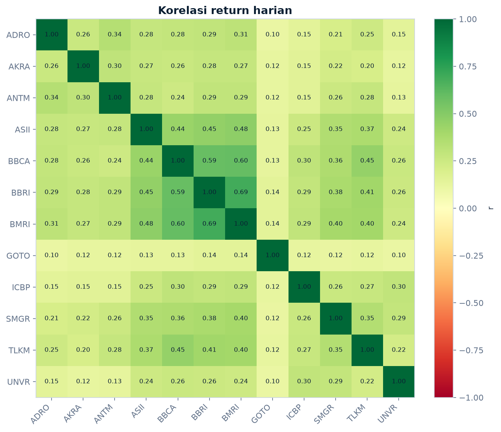
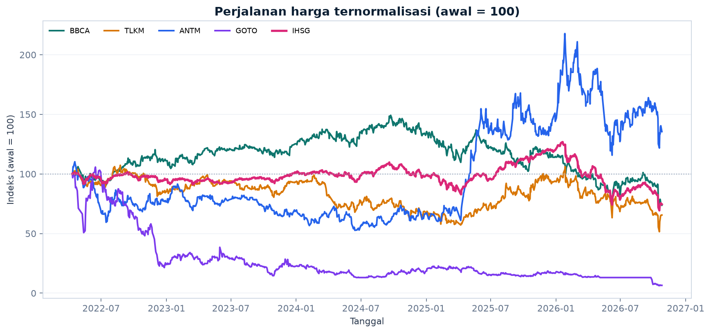
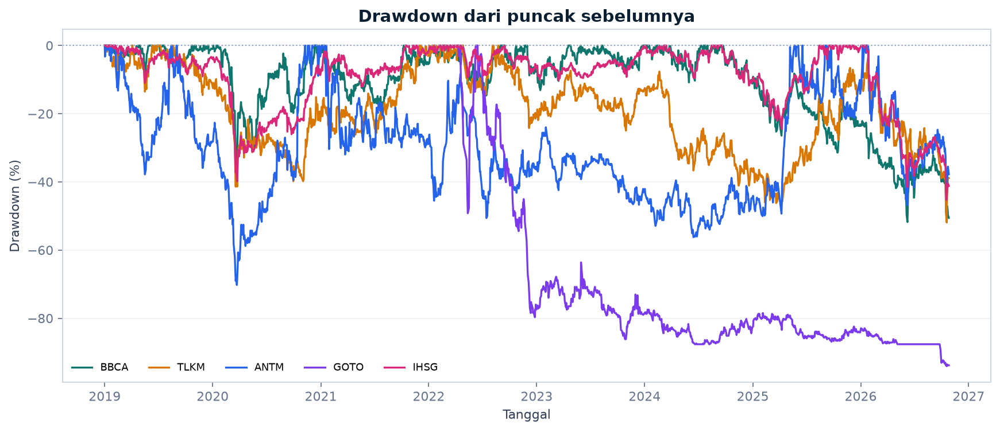
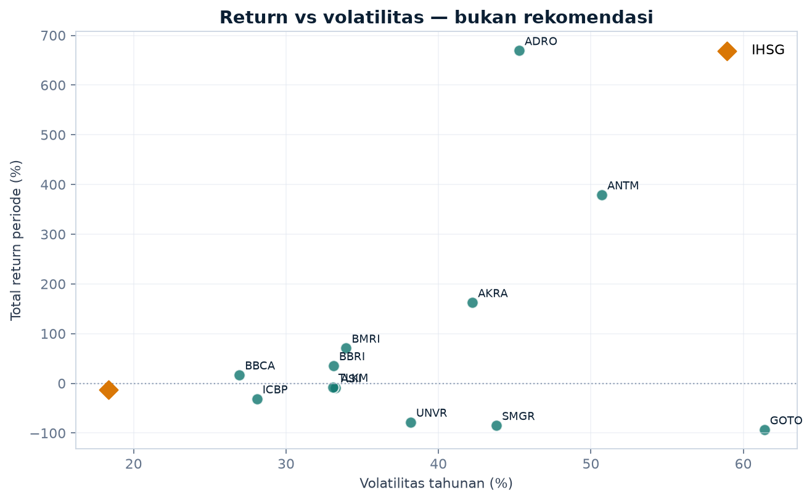
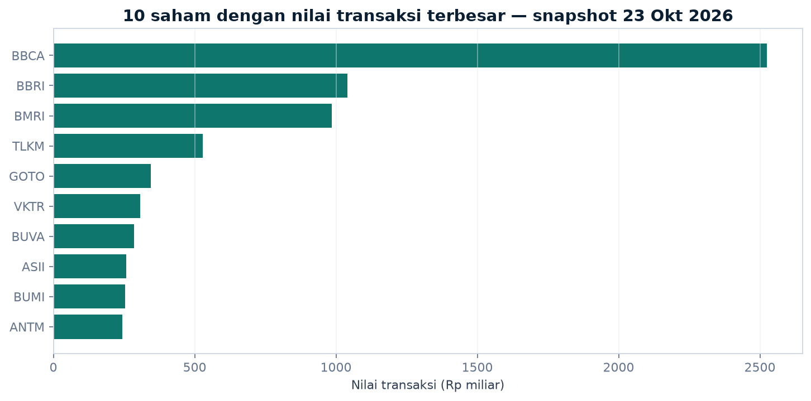
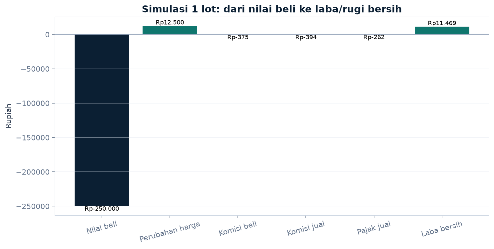

# Laporan Analisis Saham Indonesia

Dibuat: **27 Okt 2026, 10:20 WIB**  
Proyek: **SahamLab — belajar saham, analisis data, dan simulasi lokal**

> Laporan ini adalah alat belajar dan eksplorasi data, **bukan rekomendasi beli/jual**.
> Angka historis tidak menjamin hasil masa depan. Harga bisa turun dan modal bisa berkurang.

## 1. Ringkasan data

| Komponen | Nilai |
| --- | --- |
| Snapshot IDX | 963 saham, 1 tanggal (2026-10-23) |
| Data historis | 23,856 baris, 13 ticker |
| Rentang historis | 01 Jan 2019 – 26 Okt 2026 |
| Sumber historis | Yahoo Finance melalui `yfinance`, diambil 2026-10-27T09:53:57+07:00 |
| Saham dalam dataset | 12 saham + IHSG |
| Harga untuk return | `Adj Close` |
| Harga untuk valuasi | `Close` |

Snapshot dan data historis **tidak boleh dicampur**. Snapshot hanya potret satu hari.
Analisis tren, return, risiko, dan korelasi memakai data historis.

## 2. Kualitas data

### Snapshot

- Missing value: **0**
- Duplikat baris: **0**
- Duplikat ticker: **0**
- Saham tanpa transaksi: **130**
- Saham diperdagangkan dengan `Open Price = 0`: **204** (diperlakukan sebagai tidak tersedia)
- OHLC tidak wajar: **0**
- Total nilai transaksi snapshot: **Rp13.92 T**

### Historis

- Missing value: **0**
- Duplikat (ticker + tanggal): **0**
- OHLC tidak wajar: **0**
- Baris volume nol: **164**
- GOTO memiliki riwayat lebih pendek karena baru tercatat pada 2022.

## 3. Performa historis

Periode: **01 Jan 2019 – 26 Okt 2026**.
Return dan risiko dihitung dari `Adj Close`, bukan dari snapshot satu hari.

| Ticker | Observasi | Total return | CAGR | Volatilitas | Max drawdown |
| --- | --- | --- | --- | --- | --- |
| ADRO | 1.898 | +669,5% | +29,8% | 45,3% | -59,2% |
| ANTM | 1.899 | +379,2% | +22,2% | 50,7% | -70,3% |
| AKRA | 1.899 | +162,5% | +13,1% | 42,2% | -72,9% |
| BMRI | 1.899 | +70,8% | +7,1% | 33,9% | -52,1% |
| BBRI | 1.899 | +35,5% | +4,0% | 33,1% | -52,4% |
| BBCA | 1.899 | +17,0% | +2,0% | 26,9% | -51,8% |
| TLKM | 1.898 | -7,7% | -1,0% | 33,1% | -51,9% |
| ASII | 1.898 | -9,2% | -1,2% | 33,2% | -60,1% |
| IHSG | 1.886 | -13,1% | -1,8% | 18,4% | -45,3% |
| ICBP | 1.898 | -31,1% | -4,7% | 28,1% | -52,0% |
| UNVR | 1.899 | -78,1% | -17,7% | 38,2% | -87,6% |
| SMGR | 1.899 | -84,7% | -21,3% | 43,8% | -89,3% |
| GOTO | 1.085 | -93,5% | -45,1% | 61,4% | -94,1% |

**Catatan penting:** GOTO tidak memiliki data sebelum April 2022. Angka GOTO di atas dihitung
dari tanggal yang tersedia, sehingga tidak sepenuhnya sebanding dengan saham yang datanya
dimulai 2019. Perbandingan visual memakai tanggal awal yang sama.

## 4. Risiko historis

| Ticker | Volatilitas | Downside dev. | Max drawdown | VaR 95% harian | Hari negatif |
| --- | --- | --- | --- | --- | --- |
| BBCA | 26,9% | 18,3% | -51,8% | 2,3% | 46,6% |
| ICBP | 28,1% | 19,7% | -52,0% | 2,7% | 45,3% |
| TLKM | 33,1% | 22,4% | -51,9% | 2,8% | 47,1% |
| BBRI | 33,1% | 22,2% | -52,4% | 3,0% | 46,0% |
| ASII | 33,2% | 22,6% | -60,1% | 3,0% | 46,7% |
| BMRI | 33,9% | 23,3% | -52,1% | 3,1% | 45,0% |
| UNVR | 38,2% | 25,0% | -87,6% | 3,4% | 50,4% |
| AKRA | 42,2% | 27,2% | -72,9% | 4,0% | 47,0% |
| SMGR | 43,8% | 29,2% | -89,3% | 4,1% | 49,7% |
| ADRO | 45,3% | 29,1% | -59,2% | 4,0% | 45,8% |
| ANTM | 50,7% | 31,2% | -70,3% | 4,4% | 48,3% |
| GOTO | 61,4% | 40,9% | -94,1% | 6,2% | 41,1% |

VaR 95% historis adalah ambang kerugian harian pada 5% hari terburuk dalam periode ini.
VaR **bukan** batas kerugian maksimum. Volatilitas dan drawdown juga berubah bila periode diubah.

## 5. Korelasi return harian

Korelasi tertinggi: **BBRI vs BMRI = 0.69** (searah).
Korelasi terendah: **ADRO vs GOTO = 0.10** (searah).

Korelasi dihitung dari return harian pada tanggal yang tersedia untuk semua saham terpilih.
Korelasi bukan sebab-akibat dan tidak stabil sepanjang waktu.

## 6. Riset 12 saham

| Ticker | Sektor | Harga terakhir | Return periode | Volatilitas | Max DD | Likuiditas 20H |
| --- | --- | --- | --- | --- | --- | --- |
| ADRO | Energi | Rp2.450 | +669,5% | 45,3% | -59,2% | Rp108.0 M |
| ANTM | Barang Baku | Rp2.760 | +379,2% | 50,7% | -70,3% | Rp260.6 M |
| AKRA | Energi | Rp1.400 | +162,5% | 42,2% | -72,9% | Rp33.3 M |
| BMRI | Keuangan | Rp3.910 | +70,8% | 33,9% | -52,1% | Rp809.3 M |
| BBRI | Keuangan | Rp2.910 | +35,5% | 33,1% | -52,4% | Rp940.6 M |
| BBCA | Keuangan | Rp4.940 | +17,0% | 26,9% | -51,8% | Rp1.63 T |
| TLKM | Telekomunikasi | Rp2.250 | -7,7% | 33,1% | -51,9% | Rp651.2 M |
| ASII | Industri | Rp4.560 | -9,2% | 33,2% | -60,1% | Rp278.3 M |
| ICBP | Konsumen Primer | Rp5.975 | -31,1% | 28,1% | -52,0% | Rp45.3 M |
| UNVR | Konsumen Primer | Rp1.425 | -78,1% | 38,2% | -87,6% | Rp31.5 M |
| SMGR | Barang Baku | Rp1.465 | -84,7% | 43,8% | -89,3% | Rp26.3 M |
| GOTO | Teknologi | Rp25 | -93,5% | 61,4% | -94,1% | Rp476.5 M |

Kapitalisasi adalah perkiraan dari harga terakhir dataset × jumlah saham tercatat di snapshot.
Angka ini bukan kapitalisasi real-time resmi. Kolom `Tradeable/Listed` **bukan free float sebenarnya**.

## 7. Simulasi modal Rp700.000

Contoh: 1 lot (100 lembar) pada harga simulasi Rp2.500, alokasi Rp280.000, komisi beli/jual 0,15%,
pajak jual 0,1%, lalu harga naik 5%.

| Komponen | Nilai |
| --- | --- |
| Nilai saham | Rp250.000 |
| Komisi beli | Rp375 |
| Total uang keluar | Rp250.375 |
| Hasil jual bersih | Rp261.844 |
| Laba/rugi bersih | **Rp11.469** |
| Return investasi | +4,6% |
| Return terhadap modal | +1,6% |

Bahkan pada perubahan harga 0%, hasilnya sudah negatif karena biaya transaksi. Ini bukan
alasan untuk tidak pernah bertransaksi, tetapi alasan untuk menghitung biaya sebelum membeli.

## 8. Temuan utama (deskriptif, bukan rekomendasi)

- Return total tertinggi pada periode ini: **ADRO (+669,5%)**.
- Return total terendah pada periode ini: **GOTO (-93,5%)**.
- IHSG sebagai pembanding: **-13,1%** pada periode yang sama.
- Drawdown terdalam pada tabel risiko: **GOTO (-94,1%)**.
- Angka-angka ini hanya menggambarkan masa lalu, bukan prediksi.

## 9. Grafik

### Harga ternormalisasi

### Drawdown

### Return vs volatilitas

### Snapshot: nilai transaksi terbesar

### Simulasi biaya

## 10. Keterbatasan

1. Dataset hanya **12 saham + IHSG**, bukan seluruh bursa. Tidak bisa mewakili pasar Indonesia.
2. Sumber historis adalah **Yahoo Finance**, pihak ketiga yang bisa terlambat, tidak lengkap,
   atau berubah tanpa pemberitahuan.
3. Tidak ada data fundamental perusahaan nyata yang terverifikasi di proyek ini.
4. Tidak ada data intraday, bid/ask real-time, atau integrasi broker.
5. Hasil mengandung **survivorship bias** bila dipakai untuk menyimpulkan strategi jangka panjang,
   karena daftar saham dipilih saat proyek dibuat.
6. Return dan risiko sangat bergantung pada periode, tanggal mulai, dan kualitas data.
7. Simulasi belum memasukkan slippage, likuiditas, perubahan fraksi harga, dividen, dan pajak lain.
8. Korelasi, CAGR, dan drawdown bukan jaminan kinerja masa depan.

## 11. File keluaran

- `outputs/reports/performance_metrics.csv`
- `outputs/reports/risk_metrics.csv`
- `outputs/reports/correlation_matrix.csv`
- `outputs/reports/research_table.csv`
- `outputs/reports/quality_snapshot.csv`
- `outputs/reports/quality_historical.csv`
- `outputs/charts/*.png`
- `notebooks/01_data_understanding.ipynb` sampai `notebooks/04_eda.ipynb`

---

**Pengingat:** proyek ini tidak terhubung ke broker, tidak mengirim order, dan tidak memberi
rekomendasi saham. Jangan memakai utang atau uang kebutuhan untuk berinvestasi.
